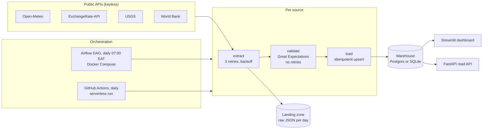

# Kenya Daily Data Pipeline

 

An end-to-end data engineering project. Every morning it collects four free public datasets about Kenya, checks each one with Great Expectations, and loads only clean data into a warehouse. The results are served through a live dashboard and a REST API. Bad data fails the run instead of being loaded.

**Live dashboard:** _add your Streamlit Cloud link here after deploying (see below)_

| Source | What | Key needed |
| --- | --- | --- |
| [Open-Meteo](https://open-meteo.com/) | Daily max/min temperature and rainfall for Nairobi, Mombasa and Kisumu | No |
| [ExchangeRate-API open access](https://www.exchangerate-api.com/docs/free) | USD exchange rates for about 160 currencies, including KES, UGX and TZS | No |
| [USGS Earthquake API](https://earthquake.usgs.gov/fdsnws/event/1/) | Earthquakes in the East African Rift region | No |
| [World Bank API](https://datahelpdesk.worldbank.org/knowledgebase/articles/889392) | Kenya inflation, GDP and population by year | No |

## Architecture



The same `pipeline` package runs in two places:
1. **Airflow, in Docker Compose.** This is the full production-style setup: a scheduler, a web UI, and a Postgres warehouse alongside the dashboard and API.
2. **GitHub Actions, daily (`daily.yml`).** This is the serverless deployment. It downloads the current SQLite warehouse from the repo's `data` release, loads yesterday's data through the same quality gates, and publishes the updated warehouse back. The public dashboard reads that file. If a quality check fails, the run is marked failed on GitHub and that source is skipped for the day.

### Design choices
- **Keep the raw data.** Raw JSON lands in a landing zone (`data/landing/<source>/<date>.json`), so any day can be re-validated or reloaded without calling the API again.
- **Retry only where it helps.** Network calls retry 3 times with growing waits. Validation never retries, because bad data stays bad.
- **Idempotent loads.** Every table has a natural primary key and loads use `INSERT ... ON CONFLICT DO UPDATE`, so retries and backfills never create duplicates.
- **Audit trail.** `pipeline_runs` records rows loaded and checks passed, per source, per run. The dashboard shows it as the data-quality history.
- **One package, three consumers.** The Airflow DAG is a thin wrapper around `pipeline/`. The dashboard and API share `pipeline/queries.py`, so they always show the same numbers.

## Data-quality checks (27 expectations)

| Suite | Checks |
| --- | --- |
| weather (11) | exactly 3 cities; unique city+date; no nulls; max 0–50 °C; min −5–40 °C; max ≥ min; rain 0–500 mm |
| fx_rates (6) | at least 100 currencies; unique 3-letter codes; rates > 0; KES, UGX, TZS and EUR present |
| earthquakes (5) | unique event ids; time present; magnitude −1 to 10; inside the East Africa bounding box. Zero rows is valid |
| kenya_indicators (5) | at least 3 rows; unique indicator+year; known indicators only; year 1960–2100; no nulls |

### A real catch
While backfilling 60 days of history, the weather suite rejected 15–17 August 2026. Open-Meteo's forecast endpoint only keeps recent days and had returned empty temperatures and rainfall for those dates. The null checks stopped the blanks from being loaded, and the run reported exactly which fields were missing.

The fix was in the source, not the checks: dates older than a week now come from Open-Meteo's historical archive. All three days then loaded with 11/11 checks passing, and a unit test now covers which endpoint each date uses.

## Run it with Docker (Airflow + Postgres + dashboard + API)

Needs [Docker Desktop](https://www.docker.com/products/docker-desktop/).

```bash
cp .env.example .env          # set the passwords
docker compose up airflow-init
docker compose up -d
```

| Service | URL |
| --- | --- |
| Airflow | http://localhost:8080 (log in with `AIRFLOW_ADMIN_USER` / `AIRFLOW_ADMIN_PASSWORD`) |
| Dashboard | http://localhost:8501 |
| API docs | http://localhost:8000/docs |

In Airflow, unpause `kenya_daily_pipeline` and click **Trigger DAG**.

## Run it without Docker

```bash
python -m venv venv
source venv/Scripts/activate        # venv/bin/activate on macOS/Linux
pip install -r requirements-dev.txt
python -m pipeline.run_local --backfill 30    # the last 30 days into data/warehouse.db
pip install -r requirements-serve.txt
streamlit run dashboard/app.py
uvicorn api.main:app --port 8000
```

## REST API

| Endpoint | Returns |
| --- | --- |
| `GET /health` | status plus headline numbers (latest USD→KES rate, days of weather, last run's checks) |
| `GET /weather?city=Nairobi&days=30` | daily weather |
| `GET /fx/KES` | USD→KES rate history |
| `GET /earthquakes?min_magnitude=4` | earthquakes, newest first |
| `GET /indicators` | World Bank series for Kenya |
| `GET /runs?limit=40` | data-quality history |

## Deploy the live dashboard (free)

1. In this repo on GitHub, go to **Actions → Daily run → Run workflow** once. This creates the `data` release with the first warehouse file.
2. Go to [share.streamlit.io](https://share.streamlit.io), sign in with GitHub, and click **Create app**. Choose repo `ngugiauraa/data-pipeline`, branch `main`, main file `dashboard/app.py`.
3. Deploy. The dashboard reads the warehouse published by the daily run, so it updates itself every day.

## Tests and CI

```bash
ruff check .
pytest
```

The tests cover:
- the transforms;
- that every quality gate rejects bad data (impossible temperatures, min above max, a missing city, duplicates, nulls, a missing KES rate);
- idempotent loads;
- which weather endpoint each date uses;
- the shared queries and every API endpoint.

GitHub Actions runs the tests, parses the Airflow DAG with Airflow 2.10.4, and builds both Docker images on every push.

## Known limitations

- The free FX endpoint serves only the latest rates, so the KES history grows by one point per daily run and cannot be backfilled.
- World Bank figures are annual and lag by about a year. The latest year is often unpublished and is skipped.

## Screenshots to take

1. The live dashboard: headline numbers, weather charts and the earthquake map.
2. The Airflow grid view after a green run (13 tasks), and the graph view showing the four parallel chains.
3. A failed run, triggered on purpose:
   - Temporarily set the weather max-temperature limit in `pipeline/quality.py` to `max_value=1` and trigger the DAG.
   - Screenshot the red `validate_weather` task and its log.
   - Revert the change.
4. GitHub Actions: the green CI run, and the Daily run history.
5. The API docs at `/docs` with a `/fx/KES` response.

## Project layout

```
dags/kenya_daily_pipeline.py   Airflow DAG (thin wrapper)
pipeline/sources.py            fetch and transform for each API
pipeline/quality.py            Great Expectations suites; raises DataQualityError
pipeline/storage.py            warehouse tables and idempotent upserts (Postgres or SQLite)
pipeline/tasks.py              extract / validate / load, shared by Airflow and local runs
pipeline/run_local.py          run without Airflow, with --backfill
pipeline/queries.py            read-side queries shared by the dashboard and API
dashboard/app.py               Streamlit dashboard
api/main.py                    FastAPI read API
.github/workflows/             CI and the daily serverless run
docker-compose.yml             Airflow, Postgres, dashboard and API
tests/                         offline tests, no network
```
