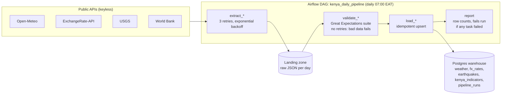

# Kenya Daily Data Pipeline

An Apache Airflow pipeline that collects four free public datasets about Kenya every morning. It checks each one with Great Expectations, and only clean data reaches a Postgres warehouse. Bad data fails the run instead of being loaded.

| Source | What | Key needed |
| --- | --- | --- |
| [Open-Meteo](https://open-meteo.com/) | Daily max/min temperature and rainfall for Nairobi, Mombasa, Kisumu | No |
| [ExchangeRate-API open access](https://www.exchangerate-api.com/docs/free) | USD exchange rates for ~160 currencies, including KES, UGX, TZS | No |
| [USGS Earthquake API](https://earthquake.usgs.gov/fdsnws/event/1/) | Earthquakes in the East African Rift region, last 7 days | No |
| [World Bank API](https://datahelpdesk.worldbank.org/knowledgebase/articles/889392) | Kenya inflation, GDP and population by year | No |

## Architecture



Each of the four sources runs its own `extract >> validate >> load` chain in parallel, so one failing source does not block the others. The final `report` task still fails the run if anything failed, and the failure shows in the Airflow UI.

Design choices, and why:
- **Raw JSON is kept** in a landing zone (`data/landing/<source>/<date>.json`), so any day can be re-validated or re-loaded without calling the API again.
- **Retries only where they help.** Network calls retry 3 times with growing waits. Validation never retries, because bad data stays bad.
- **Idempotent loads.** Every table has a natural primary key and loads use `INSERT ... ON CONFLICT DO UPDATE`, so retries and backfills never create duplicates.
- **Audit trail.** `pipeline_runs` records rows loaded and checks passed per source per run.
- **Testable without Airflow.** The logic lives in `pipeline/`. The DAG in `dags/` is a thin wrapper, and `python -m pipeline.run_local` runs the same code against SQLite.

## Data-quality checks (27 expectations)

| Suite | Checks |
| --- | --- |
| weather (11) | exactly 3 cities; unique city+date; no nulls; max 0–50 °C; min −5–40 °C; max ≥ min; rain 0–500 mm |
| fx_rates (6) | ≥ 100 currencies; unique 3-letter codes; rates > 0; KES, UGX, TZS, EUR present |
| earthquakes (5) | unique event ids; time present; magnitude −1–10; inside the East Africa bounding box. Zero rows is valid |
| kenya_indicators (5) | ≥ 3 rows; unique indicator+year; known indicators only; year 1960–2100; no nulls |

The tests in `tests/` prove the gate works. Impossible temperatures, min above max, a missing city, duplicates, nulls and a missing KES rate each fail the run.

## What has been verified

On 14 Oct 2026, with Airflow 2.10.4 and Great Expectations 1.3.13 installed under Airflow's official constraints:

- **Parse check:** `DagBag` parses the DAG with no import errors: 13 tasks, wired as shown above.
- **Successful run.** Airflow's `dag.test()` ran a full run against the live APIs: 13/13 tasks succeeded in about 14 seconds and 27/27 expectations passed. It loaded 3 weather rows, 166 FX rates, 1 earthquake and 60 World Bank values.
- **Bad-data run.** The same run with a simulated 99 °C reading for Mombasa ended like this:
  - `validate_weather` failed and `load_weather` was skipped (upstream_failed), so the bad row never reached the warehouse.
  - The other three sources still loaded.
  - `report` failed the run.
- **Tests:** 10 offline tests pass (`python -m pytest tests`).
- **Not yet run:** the Docker Compose stack, because Docker was not installed on the development laptop. Run the steps below and take the screenshots listed at the end.

## Run it with Docker (Airflow + Postgres)

Needs [Docker Desktop](https://www.docker.com/products/docker-desktop/).

```bash
cp .env.example .env          # set the passwords
docker compose up airflow-init
docker compose up -d
```

1. Open http://localhost:8080 and log in with `AIRFLOW_ADMIN_USER` / `AIRFLOW_ADMIN_PASSWORD`.
2. Unpause `kenya_daily_pipeline` and click **Trigger DAG**.
3. Query the warehouse:

   ```bash
   docker compose exec postgres psql -U warehouse -d warehouse -c "select * from pipeline_runs order by loaded_at desc limit 8;"
   ```

## Run it without Docker (development)

```bash
python -m venv venv
source venv/Scripts/activate     # Windows Git Bash; use venv/bin/activate on macOS/Linux
pip install -r requirements-dev.txt
python -m pipeline.run_local     # yesterday's data into data/warehouse.db (SQLite)
python -m pytest tests
```

## Known limitations

- The free FX endpoint only serves the latest rates, so a backfill for a past date stores that day's *current* rates. The `rate_date` column records which day the rates are really from.
- World Bank figures are annual and lag by about a year. The latest year is often not published yet and is skipped.

## Screenshots to take

1. **Airflow grid view** of `kenya_daily_pipeline` after a green run: all 13 tasks.
2. **Graph view** showing the four parallel extract → validate → load chains joining at `report`.
3. **A failed run.** Temporarily change the weather max-temperature limit in `pipeline/quality.py` to `max_value=1` and trigger the DAG. Screenshot the red `validate_weather` task and its log line `weather failed 1 check(s): expect_column_values_to_be_between(temp_max_c)`. Then revert the change.
4. **Task log of `extract_*` with a retry**, if one happens naturally. Otherwise, the retry settings in the task's "Task Instance Details".
5. **Warehouse query result:** `select * from pipeline_runs` showing rows loaded and checks passed per source.
6. **Terminal:** `python -m pytest tests` passing.

## Project layout

```
dags/kenya_daily_pipeline.py   Airflow DAG (thin wrapper)
pipeline/sources.py            fetch_* and transform_* for each API
pipeline/quality.py            Great Expectations suites; raises DataQualityError
pipeline/storage.py            warehouse tables and idempotent upserts (Postgres or SQLite)
pipeline/tasks.py              extract / validate / load shared by Airflow and local runs
pipeline/run_local.py          run everything once without Airflow
docker/postgres-init/          creates the warehouse database on first start
tests/                         offline tests, no network
```
